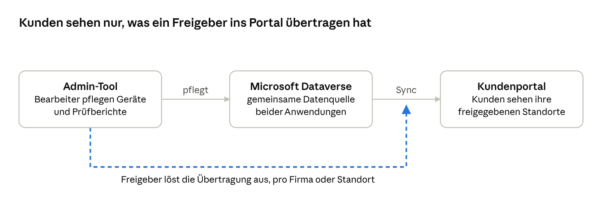

# Management Summary: Admin-Tool und Kundenportal

Stand: 11. Oktober 2026 · Robert Bienz

> Ablage-Kopie des Claude-Docs [Management Summary: Admin-Tool und Kundenportal](https://claude.ai/code/artifact/65cfbcfb-251e-4f29-b4c7-baf56a0ec835). PDF: [management-summary-2026-10-11.pdf](management-summary-2026-10-11.pdf).

## Auf einen Blick

OBSI Hofer betreibt zwei Web-Anwendungen, die auf denselben Daten in Microsoft Dataverse aufbauen:

- **Admin-Tool (intern):** Mitarbeitende pflegen hier Geräte und Prüfberichte, erstellen PDF-Prüfberichte und entscheiden, welche Kunden-Kontakte welchen Standort im Portal sehen.
- **Kundenportal (extern):** Kunden sehen dort rund um die Uhr ihre Geräte, deren Prüfstatus und Prüfhistorie, ohne bei OBSI Hofer nachfragen zu müssen.

Der Kernnutzen: Daten werden einmal sauber erfasst und erst dann für den Kunden sichtbar, wenn OBSI Hofer sie freigibt — pro Firma oder pro Standort.

## Ausgangslage

Bisher lief vieles von Hand und ohne Kontrolle, wann Kunden welche Daten sehen:

- **Datenpflege direkt in Dataverse/Dynamics:** Geräte und Prüfberichte wurden in der Standard-Oberfläche erfasst, ohne auf die Arbeit zugeschnittene Masken und mit entsprechendem Fehlerrisiko.
- **Prüfberichte per Excel und E-Mail:** Berichte für Kunden wurden manuell in Excel aufbereitet und verschickt.
- **Automatischer nächtlicher Abgleich:** Das Portal übernahm jede Nacht um 03:00 alle Daten, auch halbfertig bearbeitete.

## Admin-Tool (intern)

Das Admin-Tool ersetzt die direkte Bearbeitung in Dataverse. Die Anmeldung läuft über das bestehende Microsoft-365-Konto, mit zwei Rollen: **Bearbeiter** pflegen Daten, **Freigeber** entscheiden zusätzlich über den Kundenzugang und die Veröffentlichung.

| Funktion | Was sie leistet | Rolle |
| --- | --- | --- |
| Arbeitskontext Firma → Standort | Alle Ansichten und PDFs beziehen sich auf den gewählten Standort einer Firma | alle |
| Geräte-Verwaltung | Geräte anzeigen und bearbeiten, live gegen Dataverse | Bearbeiter |
| Prüfberichte | Prüfberichte erfassen und bearbeiten; Fehlerfassungen werden storniert statt gelöscht | Bearbeiter |
| PDF-Prüfbericht | Erstellt den Prüfbericht als PDF nach der Excel-Vorlage des Kunden und legt ihn im SharePoint-Archiv ab | Bearbeiter |
| Kundenportal-Zugang | Pro Kontakt und Standort festlegen, wer im Portal was sieht | Freigeber |
| Freigabe & Synchronisation | Überträgt die Daten einer Firma oder eines Standorts gezielt ins Portal | Freigeber |
| Sync-Verlauf | Zeigt pro Firma bzw. Standort, wann wer was übertragen hat und mit welchem Ergebnis | Freigeber |

## Kundenportal (extern)

Das Kundenportal ist ein reines Lese-Portal für die Kunden von OBSI Hofer. Kunden können sich nicht selbst registrieren: Zugang erhält nur, wen ein Freigeber im Admin-Tool für einen Standort freischaltet. Die Anmeldung erfolgt mit einem Einmal-Code per E-Mail oder mit Passkey, ohne Passwort.

| Funktion | Was der Kunde damit tut |
| --- | --- |
| Dashboard | Sieht auf einen Blick Geräte pro Status, Anzahl Prüfberichte und die letzte Prüfung |
| Geräte-Übersicht | Durchsucht und filtert seine Geräte mit Prüfstatus, Bemerkung der letzten Prüfung und kundenspezifischen Spalten; bei mehreren Standorten mit Standort-Filter |
| Geräte-Detail | Sieht die gesamte Prüfhistorie eines Geräts |
| Prüfberichte-Übersicht | Sieht alle Prüfberichte seiner Firma bzw. seiner Standorte |
| CSV-Export | Exportiert Geräte- und Prüfberichte-Übersicht für die eigene Weiterverarbeitung |

Intern wertet OBSI Hofer die Nutzung aus: Ein wöchentlicher E-Mail-Report zeigt, wie viele Kunden sich anmelden.

## Zusammenspiel

Das Admin-Tool schreibt direkt in Dataverse. Das Portal arbeitet mit einer eigenen Kopie der Daten, die nur auf Freigabe aktualisiert wird; einen automatischen nächtlichen Abgleich gibt es nicht mehr.

## Nutzen

Der Nutzen liegt vor allem in weniger Handarbeit bei OBSI Hofer und in mehr Selbstständigkeit für die Kunden.

**Für OBSI Hofer**

- **Weniger Aufwand:** Keine manuelle Excel-Aufbereitung und kein E-Mail-Versand von Prüfberichten mehr; das PDF entsteht per Knopfdruck nach der Vorlage des Kunden und wird automatisch archiviert.
- **Weniger Fehler:** Zugeschnittene Erfassungsmasken statt der Dataverse-Standardoberfläche; Prüfberichte werden storniert statt gelöscht, die Historie bleibt nachvollziehbar.
- **Kontrolle über die Veröffentlichung:** Kunden sehen Daten erst nach der Freigabe, also erst wenn sie fertig bearbeitet sind, und gezielt pro Firma oder Standort.
- **Sauber geregelter Zugang:** Pro Kontakt und Standort festgelegt und protokolliert; wer keinen Zugang mehr haben soll, verliert ihn mit der nächsten Freigabe.
- **Messbarkeit:** Der Sync-Verlauf zeigt jede Übertragung, der Nutzungs-Report die Akzeptanz bei den Kunden.

**Für die Kunden**

- **Selbstbedienung rund um die Uhr:** Gerätestatus und Prüfhistorie jederzeit abrufbar, ohne Nachfrage bei OBSI Hofer.
- **Überblick über fällige Prüfungen:** Status und letzte Prüfung pro Gerät auf einen Blick.
- **Eigene Weiterverarbeitung:** CSV-Export für interne Auswertungen oder Audits.
- **Einfache, sichere Anmeldung:** Einmal-Code oder Passkey, kein Passwort zu verwalten; jeder Kontakt sieht nur die für ihn freigegebenen Standorte.

## Stand und nächste Schritte

Beide Anwendungen sind produktiv. Alle oben beschriebenen Funktionen sind live, zuletzt kamen am 9. bis 11. Oktober 2026 Zugang und Synchronisation pro Standort hinzu.

| Vorhaben | Anwendung | Stand |
| --- | --- | --- |
| Digital signiertes PDF mit elektronischem Firmen-Siegel von OBSI Hofer | Admin-Tool | Technisch vorbereitet und getestet; für den Echtbetrieb fehlt ein kostenpflichtiges Siegel-Zertifikat, Anbieter noch zu wählen |
| PDF-Prüfbericht direkt im Portal, im gleichen Layout wie das Admin-Tool | Kundenportal | Spezifiziert, noch nicht gebaut |
| Bereinigung von Abweichungen zwischen den Anwendungen | beide | Geprüft am 11. Oktober 2026; wichtigster Punkt: stornierte Prüfberichte sind im Portal noch sichtbar, Entscheidung offen |
| Datenqualität in Dataverse | Stammdaten | 1'726 Prüfberichte ohne Gerätezuordnung, 4 doppelte Kontakte aus Bexio, 269 Geräte mit zwei Prüfberichten am selben Tag — Bereinigung in Dataverse bzw. Bexio |
